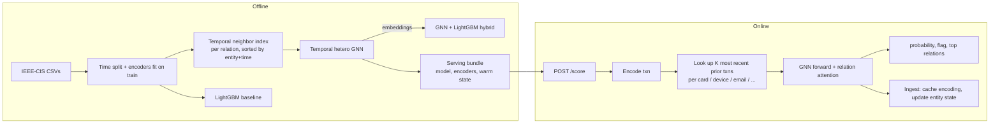

# Real-Time Graph Fraud Detection (Temporal Heterogeneous GNN)

[](https://github.com/ANUVIK2401/GNN-fraud-detection/actions/workflows/ci.yml)
[](LICENSE)

Scores card transactions for fraud in real time by looking at **who else recently used the same card, device, email domain or address**. Trained and evaluated on IEEE-CIS (590K transactions), compared against a LightGBM baseline on the same leakage-free split, and served as a FastAPI service whose online scores match offline evaluation.

**Highlights**

- **Time-respecting graph sampling.** A transaction only sees the K most recent *earlier* transactions on each shared entity. No future neighbors, no test labels, nothing a live system could not see.
- **Leakage-free evaluation.** Split by `TransactionDT` (60/20/20). Encoders, entity vocabularies and the decision threshold are fit on train/val only. Test is touched once.
- **Honest baselines.** LightGBM on the same features and entity ids, plus a GNN-embedding + LightGBM hybrid.
- **Real-time serving.** In-memory neighbor state with cached transaction encodings, so each request does one small forward pass. Online scores are verified against offline scores in CI.
- **Explainable.** Relation-level attention says which link (card, device, email...) drove each score.

## Results

<!-- RESULTS:START -->
Time-based split on TransactionDT. Test = last 118,108 transactions (3.44% fraud). Threshold chosen on validation, applied once to test.

| Model | PR-AUC | ROC-AUC | Recall @1% FPR | Precision | Recall | F1 |
|---|---|---|---|---|---|---|
| LightGBM (features + entity ids) | 0.5009 | 0.8764 | 0.4368 | 0.6097 | 0.4355 | 0.5081 |
| Temporal hetero GNN | 0.3994 | 0.8432 | 0.3189 | 0.4951 | 0.3474 | 0.4083 |
| GNN embeddings + LightGBM | 0.4780 | 0.8569 | 0.4134 | 0.5396 | 0.4446 | 0.4875 |

## Which relations the GNN attends to (mean test attention)

| Relation | Weight |
|---|---|
| card1 | 0.373 |
| card2 | 0.233 |
| addr1 | 0.078 |
| card6 | 0.077 |
| R_emaildomain | 0.044 |
| P_emaildomain | 0.036 |
| card3 | 0.036 |
| ProductCD | 0.026 |
| card5 | 0.024 |
| DeviceInfo | 0.015 |
| card4 | 0.014 |
| addr2 | 0.012 |
| id_33 | 0.009 |
| id_30 | 0.009 |
| id_31 | 0.008 |
| DeviceType | 0.007 |

## Serving latency (in-process, model + neighbor lookup + state update)

| Device | Batch | p50 ms | p99 ms | txn/s |
|---|---|---|---|---|
| cpu | 1 | 1.175 | 1.364 | 808.2 |
| cpu | 8 | 3.005 | 3.435 | 2541.7 |
| cpu | 32 | 8.306 | 9.015 | 3693.3 |
| cpu | 128 | 28.723 | 31.843 | 4205.3 |
<!-- RESULTS:END -->

Plots: [`results/pr_curve.png`](results/pr_curve.png), [`results/val_pr_auc.png`](results/val_pr_auc.png). Full numbers: [`results/`](results/).

## Findings

- **LightGBM is the strongest single model here** (test PR-AUC 0.50 vs 0.40 for the GNN). IEEE-CIS already ships Vesta's engineered count (C*) and time-delta (D*) features, which summarize much of a card's history, so the neighbor signal the GNN adds is largely redundant with features the trees use directly.
- **The hybrid did not beat LightGBM (0.48).** GNN embeddings for training rows are in-sample (the GNN saw those labels), so LightGBM over-trusts them and generalizes worse. The fix is out-of-fold embeddings; it is listed below rather than tuned against the test set.
- **Attention concentrates on card identity** (`card1` 0.37, `card2` 0.23, then `addr1`), matching the common IEEE-CIS finding that card plus address approximates a user.
- **What the graph path buys in practice:** inductive, real-time scoring with per-relation explanations at 1.2 ms p50 / 1.4 ms p99 per transaction on CPU, and online scores that match offline evaluation.
- **v1 vs v2:** v1 reported F1 0.85; its own confusion matrix gave about 0.50, and its training loss used test labels. v2 numbers come from a leakage-free time split.

## How it works



The graph is bipartite: each transaction links to 16 entity types (`card1..6`, `addr1/2`, `P/R_emaildomain`, `ProductCD`, `DeviceType`, `DeviceInfo`, `id_30` OS, `id_31` browser, `id_33` screen). For a target transaction the model:

1. Encodes its own features with an MLP.
2. For each relation, builds an entity state from the K=10 most recent earlier transactions on that entity, using time-aware messages (`log(1 + seconds since neighbor)`), the entity's learned embedding, and its history count.
3. Combines relations with semantic attention (HAN-style), then classifies.

Neighbor lookup is a single vectorized `searchsorted` over per-relation arrays sorted by `(entity, time)`. No graph database or graph library is needed.

## What changed from v1

v1 (tag [`v1-original`](../../tree/v1-original)) was adapted from AWS's [sagemaker-graph-fraud-detection](https://github.com/awslabs/sagemaker-graph-fraud-detection) HeteroRGCN sample. Auditing it turned up problems that made its numbers unreliable:

| Issue in v1 | Fix in v2 |
|---|---|
| Training loss used labels of **all** nodes, including test nodes (`loss(pred, labels)`) | Loss on train rows only; test labels are never read during training |
| README reported F1 85%; its own confusion matrix gives **F1 ≈ 0.50** (recall 35%) | Metrics generated by code and written into this README automatically |
| Best model chosen by training loss, no validation set | Early stopping and threshold selection on a time-based validation split |
| Full static graph: test transactions' future neighbors visible during training | Strictly-past neighbor sampling, identical offline and online |
| README listed attention, residuals and batch norm the code did not have | README describes only what the code does |
| No baseline | LightGBM on the same split, plus a hybrid |

## Quickstart

```bash
pip install torch --index-url https://download.pytorch.org/whl/cpu   # or CUDA build
pip install -r requirements.txt

# 1-minute smoke run on synthetic data (numbers are meaningless, it proves the pipeline)
python scripts/make_synthetic.py --out ieee-data-synth --n 20000
bash scripts/run_all.sh ieee-data-synth

# Real data (needs ~/.kaggle/kaggle.json and the competition rules accepted)
bash scripts/download_data.sh
bash scripts/run_all.sh
```

Tests: `pytest -q` (runs the whole pipeline on synthetic data, checks the sampler never returns past-or-equal-time leakage, and checks online/offline score parity).

## Serving

```bash
docker build -t fraudgnn .          # needs artifacts/bundle from run_all.sh
docker run -p 8080:8080 fraudgnn

curl -s localhost:8080/score -H 'content-type: application/json' \
  -d "{\"transactions\": [$(head -1 artifacts/data/sample_requests.jsonl)]}"
```

```json
{"results": [{"TransactionID": 3546349, "fraud_probability": 0.031, "flagged": false,
              "top_relations": [{"relation": "card1", "weight": 0.41}, ...]}],
 "model_latency_ms": 4.8}
```

Endpoints: `POST /score` (1 to 1024 raw transactions, `ingest` flag), `GET /health`, `GET /stats` (rolling p50/p95/p99).

Benchmark: `python scripts/benchmark.py` (in-process, batch sizes 1/8/32/128) or `--url <service>` over HTTP.

## Reproduce on Google Cloud

Training runs on a 16-vCPU CPU VM (about 30 to 60 minutes end to end), so no GPU quota is needed.

```bash
# 1. In Cloud Shell: create the VM and upload your Kaggle token
bash scripts/gcp_create_vm.sh
gcloud compute scp ~/kaggle.json fraudgnn:~ --zone=us-central1-a
gcloud compute ssh fraudgnn --zone=us-central1-a

# 2. On the VM (inside tmux): test, download, preprocess, train, baselines, export, benchmark, report
tmux new -s run
curl -sL https://raw.githubusercontent.com/ANUVIK2401/GNN-fraud-detection/main/scripts/vm_run.sh | bash

# 3. On the VM: deploy the API to Cloud Run and benchmark it over HTTP
cd GNN-fraud-detection && . .venv/bin/activate
gcloud run deploy fraudgnn --source . --region us-central1 --memory 4Gi --cpu 2 \
  --max-instances 1 --allow-unauthenticated
python scripts/benchmark.py --url "$(gcloud run services describe fraudgnn --region us-central1 --format='value(status.url)')" \
  --batch-sizes 1 --concurrency 4
python scripts/report.py

# 4. Delete the VM when done
gcloud compute instances delete fraudgnn --zone=us-central1-a
```

## Limitations

- GNN + LightGBM hybrid uses in-sample train embeddings; out-of-fold embeddings (K-fold over time) are the next experiment.

- Neighbor state lives in one process, so the service runs as a single instance. Horizontal scaling needs a shared store (Redis or a graph DB) keyed the same way.
- Entity embeddings exist only for entities seen in training. New cards and devices still get neighbor and history signal, but a zero embedding.
- Neighbor *labels* are not used. In production, confirmed fraud on a shared card is a strong signal, available with a delay; adding it needs label-delay modeling.
- IEEE-CIS features are anonymized, so feature-level explanations are limited.

## Project structure

```
fraudgnn/
  config.py      relations, split fractions, hyperparameters
  data.py        loading, time split, FeatureEncoder, EntityIndex
  graph.py       TemporalNeighborIndex (strictly-past K-recent sampling)
  model.py       TemporalHeteroGNN
  preprocess.py  raw CSVs -> arrays
  train.py       training, early stopping, test evaluation
  baseline.py    LightGBM + hybrid
  export.py      serving bundle with warm neighbor state
  serve/         OnlineScorer + FastAPI app
scripts/         download, synthetic data, run_all, benchmark, report
tests/           sampler, encoders, end-to-end, online/offline parity, API
```

## License

MIT. v1 model code derived from AWS's Apache-2.0 sample, credited above.
